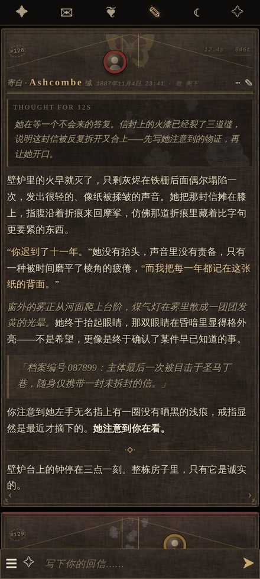
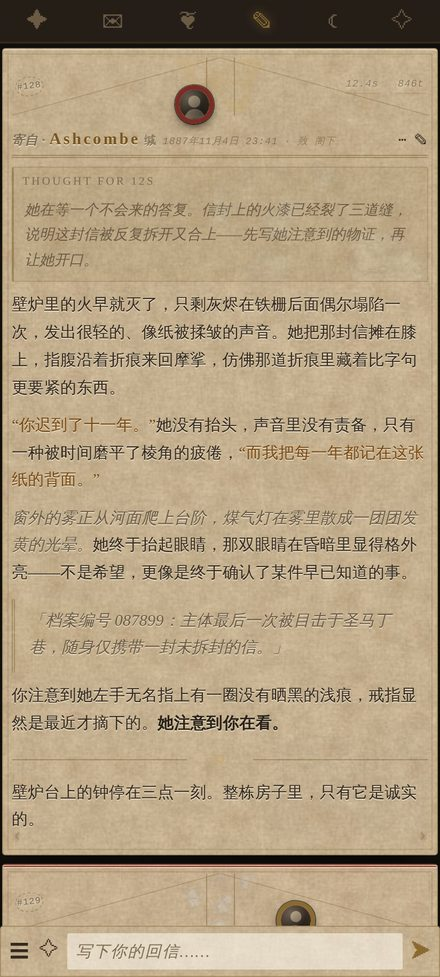

# 夜笺 · Nocturne

SillyTavern 酒馆美化主题。维多利亚暗黑 / 书信档案卡片风：亚麻暗底、烫金细线、四角花纹、旧照片头像，正文按信笺排版。
另附一套**浅羊皮纸配色**，同一套版式换个皮就能用。

卡片版式：

```
┌─────────────────────────────────────────┐
│(#128)╲        ▓火漆▓        ╱ 12.4s 846t │ ← 信封封口：折线 + 细绳 + 火漆头像
│        ╲__________________╱              │   左邮戳 / 右邮资批注
│ 寄自·角色名 缄   11月4日 23:41 · 致 阁下 │ ← 落款行
│ ═══════════════════════════════════════ │ ← 双线
│ 正文从这里开始，整行铺满，              │
│ 左右到屏幕的距离完全相同……              │
│ ‹                                     › │ ← 翻页箭头收在左右下角
└─────────────────────────────────────────┘
```

信封页眉是**单独一层**（`css/nocturne-envelope.css`），删掉它就回到朴素页眉：头像在左、编号在右、素材装饰压在右侧。

兼容 **SillyTavern 1.14.x / 1.15.x**（1.16 ~ 1.18 也能直接用：这几版消息 DOM 与主题变量没有变化）。

| 信封页眉 · 暗夜（默认） | 信封页眉 · 浅羊皮纸 | 素页版（不带信封） |
| --- | --- | --- |
|  |  |  |

桌面端：[信封版](preview/shots/envelope-desktop-dark.jpg) · [素页暗夜](preview/shots/desktop-dark.jpg) · [素页浅色](preview/shots/desktop-parchment.jpg)

---

## 一、安装：二选一

### 方式 A：导入主题预设（推荐，一步到位）

`themes/` 里有三个预设，按口味挑一个：

| 预设 | 内容 |
| --- | --- |
| `夜笺 Nocturne.json` | 默认。内嵌贴图 + 信封页眉 |
| `夜笺 Nocturne 素页版.json` | 内嵌贴图，不带信封页眉 |
| `夜笺 Nocturne 外链版.json` | 带信封页眉，贴图走 `/user/images/nocturne/`，只有 43 KB |

1. 下载对应的 json（前两个贴图已内嵌，不用另外放文件）。
2. 酒馆 → **用户设置（人像齿轮图标）→ UI 主题 → 主题预设旁的「导入」按钮** → 选这个 json。
3. 导入后在主题下拉里选 **夜笺 Nocturne**。

预设里除了 CSS，还顺手把配套设置调好了：方形头像、平铺聊天样式、显示时间戳 / 消息编号 / token 数、紧凑输入栏。

> 内嵌版约 330~340 KB，因为贴图是 base64 塞在 CSS 里的。嫌大就用外链版（43 KB），但要先按方式 B 把贴图放到位。

### 方式 B：自定义 CSS + 外链贴图（文件小、改起来方便）

1. 把 `assets/nocturne/` 整个目录复制到酒馆的
   `data/default-user/user/images/nocturne/`
   （酒馆会把这个目录暴露成 `/user/images/nocturne/...`，所以路径必须一致）。
2. 打开 `css/nocturne.css`，全选复制。
3. 酒馆 → 用户设置 → UI 主题 → **自定义 CSS**，粘贴进去。
4. 想要信封页眉，再把 `css/nocturne-envelope.css` 接在后面；想要浅色皮，见下面的「叠加顺序」。保存。

放完之后目录应该长这样：

```
SillyTavern/data/default-user/user/images/nocturne/
├── tex-linen.jpg
├── tex-parchment.jpg
├── tex-vignette.png
├── bg-night-garden.jpg
├── dec-butterfly-engraved.png
├── dec-flowers.png
├── dec-news-scrap.png
├── dec-score.png
└── …（其余装饰图可留可删）
```

### 叠加顺序

自定义 CSS 里按这个顺序往下贴，要哪层贴哪层：

```
css/nocturne.css            ← 必须，主题本体
css/nocturne-parchment.css  ← 可选，换成浅羊皮纸配色
css/nocturne-envelope.css   ← 可选，页眉变信封
```

顺序不能反：后面的层靠覆盖前面的规则生效。

---

## 一之二、信封页眉

把每条消息的页眉做成一只封好的信：

- **封口**：两条斜折线交于中央，加两道细绳（颜色跟着 `--n-gold-soft` 走，换浅色皮自动加深）。
- **火漆**：头像变成圆形，套一圈不规则的蜡边，带压印高光，稍微探出封口压在落款行上。
  角色是深红蜡（`--n-wax`），用户是黄铜蜡（`--n-wax-user`）。
- **邮戳与批注**：楼层号 `#128` 变成盖歪了的虚线圆邮戳，耗时 / token 变成右侧带下划线的邮资批注。
- **落款**：`寄自 · 角色名 缄　日期 · 致 阁下`。用户消息是「回函 ·」+「致 卿」，系统消息是「存档 ·」。

| 变量 | 作用 | 默认 |
| --- | --- | --- |
| `--n-seal` | 火漆直径 | 50px（手机 40 / 小屏 36） |
| `--n-wax` / `--n-wax-user` | 角色 / 用户的蜡色 | `#7c2b25` / `#8a6a2f` |
| `--n-twine` | 细绳颜色 | 跟随 `--n-gold-soft` |
| `--n-header-h` | 封口高度 | 72px（手机 60 / 小屏 54） |

**改称呼**：CSS 读不到对话另一方的名字，所以收件人用的是书信通称。想改就改这几处 `content` 里的字：
`.name_text::before`（寄自 / 回函 / 存档）、`.name_text::after`（缄）、`.timestamp::after`（致 阁下 / 致 卿）。

**嫌信封太满**：把 `--n-header-h` 调到 56px、`--n-seal` 调到 40px，封口会矮一截；
只想去掉细绳就删掉 `::before` 里那两行 `--n-twine` 的渐变。

---

## 二、几个常用的调节旋钮

全部集中在 CSS 顶部的 `:root` 里，改完保存即时生效。

| 变量 | 作用 | 默认 | 建议范围 |
| --- | --- | --- | --- |
| `--n-edge` | 聊天区左右留白。**越小字越靠边、每行能塞的字越多** | 桌面 8px / 手机 3px / 小屏 2px | 0 ~ 16px |
| `--n-card-pad` | 卡片内边距 | 12px（手机 9px） | 6 ~ 16px |
| `--n-card-gap` | 卡片之间的间距 | 10px（手机 8px） | 4 ~ 16px |
| `--n-header-h` | 页眉（头像那一行）的高度 | 56px（手机 48px） | 44 ~ 80px |
| `--n-watermark` | 拼贴装饰的浓度总开关（页眉素材 = 本值 ×2.6，正文水印 = ×0.5） | 0.10 | 0（关掉）~ 0.16 |
| `--n-ornament` | 四角花纹大小 | 34px（手机 26px） | 0 ~ 44px，不想要就把 `#chat .mes::after` 里的 `opacity` 设 0 |
| `--n-gold` / `--n-ink` / `--n-card` | 烫金 / 正文墨色 / 卡片底色 | — | 换配色主要改这三个 |

**字号**不在 CSS 里写死，跟随酒馆自己的「字体大小」滑块（`--mainFontSize`），所以在手机上调大字号，行高、名字、时间戳会一起等比缩放。

**换页眉装饰**：找到 `#chat .mes .mesAvatarWrapper::after` 这一段，把 `background-image` 换成别的贴图即可，
`assets/nocturne/` 里备了纸鹤 `dec-crane`、试管花信纸 `dec-letter-collage`、打字机纸条 `dec-words`、灰蝶 `dec-moth` 等，
角色 / 用户 / 系统三种消息各有一条规则，可以分别换。

**关于左右等距**：酒馆默认给正文右侧留 30px（`--mes-right-spacing`）放翻页箭头，本主题把它清零、把箭头挪到卡片左右下角，
正文两侧到屏幕的距离才真正一致。如果你另外装了会改这个变量的扩展，注意别被改回去。

---

## 三、配合的酒馆设置

主题假定这些设置（方式 A 导入预设会自动配好）：

- **聊天样式：平铺 / Default**。卡片是 CSS 画的，选「气泡」会和卡片框打架。
- **头像样式：方形**。圆头像也能用，只是旧照片边框的味道会淡一些。
- 聊天宽度滑块随意；主题不写死宽度，跟着酒馆走。
- 想要更多字：把「字体大小」调到 14~15，`--n-edge` 调到 0~2。

---

## 四、手机端

- 断点跟着酒馆自己的 `1000px` 走，另外为 `420px` 以下的小屏再收了一档。
- 卡片几乎贴屏幕边（左右各留 2~3px），把宽度全部让给正文。
- 窄屏正文改成左对齐（两端对齐在窄屏会出现大块空隙，反而难读）。
- 输入栏加了 `env(safe-area-inset-bottom)`，刘海屏 / 手势条不会挡住发送键。
- 左右滑动（swipe）箭头在手机上加大了点击区域。

---

## 五、目录结构与重新生成

```
sillytavern-nocturne/
├── css/
│   ├── nocturne.css                 主题本体（贴图走 /user/images/nocturne/）
│   ├── nocturne-parchment.css       浅羊皮纸配色（追加在主文件后面）
│   ├── nocturne-envelope.css        信封页眉（追加在最后）
│   ├── nocturne.inline.css          单文件版：贴图 base64 内嵌
│   └── nocturne.inline.lite.css     同上，去掉最大的夜色背景图
├── themes/                          可直接导入的主题预设
├── assets/nocturne/                 贴图
├── preview/preview.html             本地预览页（模拟酒馆 DOM，浏览器直接打开）
├── preview/shots/                   预览截图
└── tools/
    ├── build_assets.py              素材去背 / 裁切 / 生成无缝纹理
    ├── inline_css.py                把贴图内嵌成 base64
    └── build_theme.py               生成主题预设 json
```

改完 `css/nocturne.css` 之后，重新生成衍生文件：

```bash
python3 tools/inline_css.py                                   # 单文件版
python3 tools/inline_css.py --lite --out css/nocturne.inline.lite.css
python3 tools/build_theme.py                                  # 主题预设
```

想调整贴图（换素材、改裁切范围、改水印颜色），改 `tools/build_assets.py` 里的裁切表再跑：

```bash
python3 tools/build_assets.py --src <你的素材目录> --out assets/nocturne
```

需要 `pillow` 和 `numpy`。素材文件名在脚本开头的注释里列了。

预览页可以直接用浏览器打开 `preview/preview.html`：
`?skin=parchment` 看浅色版，`?envelope=1` 看信封页眉，两个参数可以叠加。改 CSS 后刷新即可，不用开酒馆。

---

## 六、关于素材

`assets/nocturne/` 里的贴图分两类：

- **程序化生成**：`tex-parchment` / `tex-linen` / `tex-vignette`，由脚本用噪声合成，无缝平铺，体积很小。
- **由拼贴素材加工**：黑底素材用亮度反解出 alpha 去背，幻灯片截图裁掉了水印、标题字和徽章，只保留纹理与装饰元素。

原始素材由使用者自备，本仓库只放加工后的贴图。如果要公开分发或商用，请自行确认原素材的授权。
