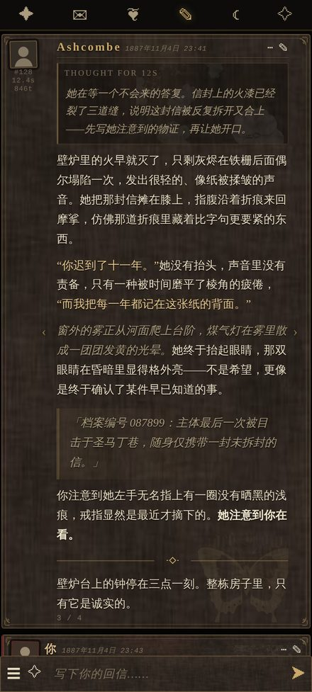
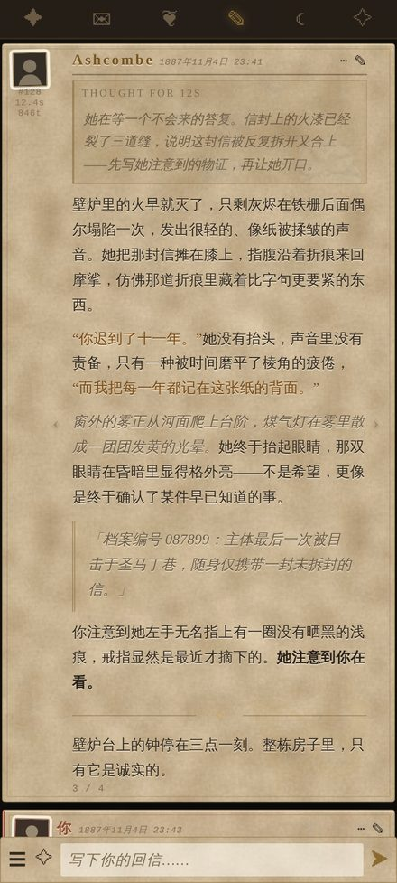

# 夜笺 · Nocturne

SillyTavern 酒馆美化主题。维多利亚暗黑 / 书信档案卡片风：亚麻暗底、烫金细线、四角花纹、旧照片头像，正文按信笺排版。
另附一套**浅羊皮纸配色**，同一套版式换个皮就能用。

兼容 **SillyTavern 1.14.x / 1.15.x**（1.16 ~ 1.18 也能直接用：这几版消息 DOM 与主题变量没有变化）。

| 暗夜（默认） | 浅羊皮纸 |
| --- | --- |
|  |  |

桌面端：[preview/shots/desktop-dark.jpg](preview/shots/desktop-dark.jpg) · [preview/shots/desktop-parchment.jpg](preview/shots/desktop-parchment.jpg)

---

## 一、安装：二选一

### 方式 A：导入主题预设（推荐，一步到位）

1. 下载 `themes/夜笺 Nocturne.json`（贴图已内嵌，不用另外放文件）。
2. 酒馆 → **用户设置（人像齿轮图标）→ UI 主题 → 主题预设旁的「导入」按钮** → 选这个 json。
3. 导入后在主题下拉里选 **夜笺 Nocturne**。

预设里除了 CSS，还顺手把配套设置调好了：方形头像、平铺聊天样式、显示时间戳 / 消息编号 / token 数、紧凑输入栏。

> 文件约 320 KB，因为贴图是 base64 内嵌的。嫌大就用方式 B，或者用 `themes/夜笺 Nocturne 外链版.json`（31 KB，需要先按方式 B 放好贴图）。

### 方式 B：自定义 CSS + 外链贴图（文件小、改起来方便）

1. 把 `assets/nocturne/` 整个目录复制到酒馆的
   `data/default-user/user/images/nocturne/`
   （酒馆会把这个目录暴露成 `/user/images/nocturne/...`，所以路径必须一致）。
2. 打开 `css/nocturne.css`，全选复制。
3. 酒馆 → 用户设置 → UI 主题 → **自定义 CSS**，粘贴进去，保存。

放完之后目录应该长这样：

```
SillyTavern/data/default-user/user/images/nocturne/
├── tex-linen.jpg
├── tex-parchment.jpg
├── tex-vignette.png
├── bg-night-garden.jpg
├── dec-butterfly-engraved.png
├── dec-flowers.png
├── dec-news-scrap.png
├── dec-score.png
└── …（其余装饰图可留可删）
```

### 想要浅羊皮纸配色

在自定义 CSS 里，**先贴 `css/nocturne.css`，再把 `css/nocturne-parchment.css` 接在它后面**。
后者只覆盖颜色，版式和手机适配都沿用主文件。

---

## 二、几个常用的调节旋钮

全部集中在 CSS 顶部的 `:root` 里，改完保存即时生效。

| 变量 | 作用 | 默认 | 建议范围 |
| --- | --- | --- | --- |
| `--n-edge` | 聊天区左右留白。**越小字越靠边、每行能塞的字越多** | 桌面 8px / 手机 3px / 小屏 2px | 0 ~ 16px |
| `--n-card-pad` | 卡片内边距 | 12px（手机 9px） | 6 ~ 16px |
| `--n-card-gap` | 卡片之间的间距 | 10px（手机 8px） | 4 ~ 16px |
| `--n-watermark` | 卡片上拼贴水印（蝴蝶 / 花枝 / 报纸）的浓度 | 0.10 | 0（关掉）~ 0.20 |
| `--n-ornament` | 四角花纹大小 | 34px（手机 26px） | 0 ~ 44px，不想要就把 `#chat .mes::after` 里的 `opacity` 设 0 |
| `--n-gold` / `--n-ink` / `--n-card` | 烫金 / 正文墨色 / 卡片底色 | — | 换配色主要改这三个 |

**字号**不在 CSS 里写死，跟随酒馆自己的「字体大小」滑块（`--mainFontSize`），所以在手机上调大字号，行高、名字、时间戳会一起等比缩放。

---

## 三、配合的酒馆设置

主题假定这些设置（方式 A 导入预设会自动配好）：

- **聊天样式：平铺 / Default**。卡片是 CSS 画的，选「气泡」会和卡片框打架。
- **头像样式：方形**。圆头像也能用，只是旧照片边框的味道会淡一些。
- 聊天宽度滑块随意；主题不写死宽度，跟着酒馆走。
- 想要更多字：把「字体大小」调到 14~15，`--n-edge` 调到 0~2。

---

## 四、手机端

- 断点跟着酒馆自己的 `1000px` 走，另外为 `420px` 以下的小屏再收了一档。
- 卡片几乎贴屏幕边（左右各留 2~3px），把宽度全部让给正文。
- 窄屏正文改成左对齐（两端对齐在窄屏会出现大块空隙，反而难读）。
- 输入栏加了 `env(safe-area-inset-bottom)`，刘海屏 / 手势条不会挡住发送键。
- 左右滑动（swipe）箭头在手机上加大了点击区域。

---

## 五、目录结构与重新生成

```
sillytavern-nocturne/
├── css/
│   ├── nocturne.css                 主题本体（贴图走 /user/images/nocturne/）
│   ├── nocturne-parchment.css       浅羊皮纸配色（追加在主文件后面）
│   ├── nocturne.inline.css          单文件版：贴图 base64 内嵌
│   └── nocturne.inline.lite.css     同上，去掉最大的夜色背景图
├── themes/                          可直接导入的主题预设
├── assets/nocturne/                 贴图
├── preview/preview.html             本地预览页（模拟酒馆 DOM，浏览器直接打开）
├── preview/shots/                   预览截图
└── tools/
    ├── build_assets.py              素材去背 / 裁切 / 生成无缝纹理
    ├── inline_css.py                把贴图内嵌成 base64
    └── build_theme.py               生成主题预设 json
```

改完 `css/nocturne.css` 之后，重新生成衍生文件：

```bash
python3 tools/inline_css.py                                   # 单文件版
python3 tools/inline_css.py --lite --out css/nocturne.inline.lite.css
python3 tools/build_theme.py                                  # 主题预设
```

想调整贴图（换素材、改裁切范围、改水印颜色），改 `tools/build_assets.py` 里的裁切表再跑：

```bash
python3 tools/build_assets.py --src <你的素材目录> --out assets/nocturne
```

需要 `pillow` 和 `numpy`。素材文件名在脚本开头的注释里列了。

预览页可以直接用浏览器打开 `preview/preview.html`，加 `?skin=parchment` 看浅色版；改 CSS 后刷新即可，不用开酒馆。

---

## 六、关于素材

`assets/nocturne/` 里的贴图分两类：

- **程序化生成**：`tex-parchment` / `tex-linen` / `tex-vignette`，由脚本用噪声合成，无缝平铺，体积很小。
- **由拼贴素材加工**：黑底素材用亮度反解出 alpha 去背，幻灯片截图裁掉了水印、标题字和徽章，只保留纹理与装饰元素。

原始素材由使用者自备，本仓库只放加工后的贴图。如果要公开分发或商用，请自行确认原素材的授权。
